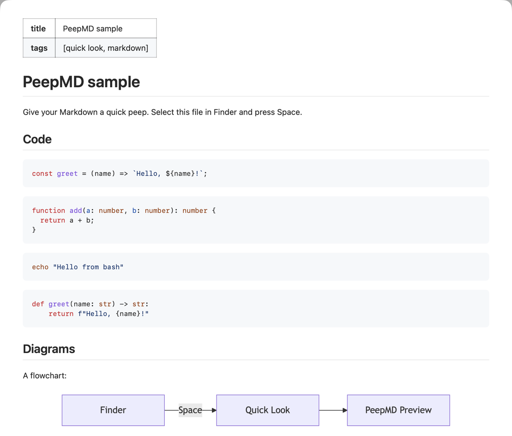
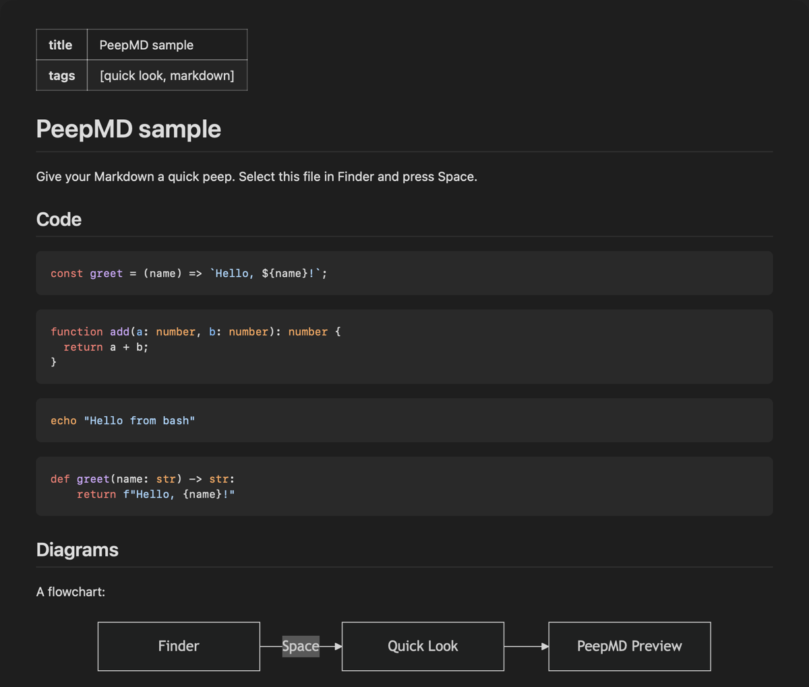

# PeepMD

Give your Markdown a quick peep.

PeepMD is a Quick Look preview for Markdown files on macOS. Select a `.md` file
in Finder, press Space, and you see the rendered document instead of plain
text. Published by [Penpoint](https://penpoint.dev).

This repository holds no code. It hosts the signed and notarized builds on the
[Releases](https://github.com/penpointdev/peepmd-releases/releases) page, this
user guide, and the [issues](#report-a-problem) for PeepMD.

| Light | Dark |
| --- | --- |
|  |  |

## What it does

- Renders GitHub Flavored Markdown: tables, task lists, strikethrough,
  autolinks and footnotes. Links to headings and footnotes jump within the
  Preview.
- Follows the system's light or dark appearance, with system fonts and colours.
- Shows YAML front matter at the start of a file as a key and value table.
- Draws Mermaid diagrams (```` ```mermaid ```` blocks).
- Highlights code blocks tagged as JavaScript, TypeScript, shell or Python.
- Shows images that sit next to the file: PNG, JPEG, GIF, WebP or SVG in the
  file's folder or below it. See [Images and the folder access
  prompt](#images-and-the-folder-access-prompt).
- Renders common README HTML, such as `<details>`, `<kbd>`, `<sup>` and
  `<p align="center">`. Scripts, event handlers, forms and styles in a file are
  removed.
- Never goes online. Remote images are never fetched: they show their alt text
  and their URL as a link. Every Preview carries a strict
  Content-Security-Policy, so only PeepMD's own scripts can run.
- Very large files (over 5 MB) show their first 256 KB as plain text.

## Requirements

macOS 26 (Tahoe) or later.

## Install with Homebrew

```sh
brew install penpointdev/tap/peepmd
open -a PeepMD
```

Then do the [first run](#first-run) steps. The
[Penpoint tap](https://github.com/penpointdev/homebrew-tap) README covers
Homebrew's tap trust, updates and uninstalling with Homebrew.

## Install by hand

1. From the [latest Release](https://github.com/penpointdev/peepmd-releases/releases/latest),
   download `PeepMD-X.Y.Z.zip` and `PeepMD-X.Y.Z.zip.sha256` into the same
   folder. X.Y.Z is the version, for example 0.1.0.

2. Check the download. In Terminal, in that folder:

   ```sh
   shasum -a 256 -c PeepMD-X.Y.Z.zip.sha256
   ```

   It must print `PeepMD-X.Y.Z.zip: OK`. If it prints `FAILED`, delete the
   zip and download it again.

   Safari can unzip downloads by itself ("Open safe files after downloading").
   If you see `PeepMD.app` and no zip, download the zip again with that
   setting off, or with another browser, to check it.

3. Unzip it: double-click the zip in Finder.

4. Move `PeepMD.app` to the Applications folder. Quick Look uses the extension
   only when the app is in an Applications folder.

5. Open PeepMD once from the Applications folder. macOS asks whether you want
   to open it: it says that PeepMD is an app downloaded from the Internet and
   that Apple checked it for malicious software and found none. Click
   **Open**. You see this only the first time.

   If macOS says instead that PeepMD is damaged, or that Apple could not check
   it for malicious software, do not open it. Delete it, download it again,
   and [check the signature](#check-the-signature).

Then do the [first run](#first-run) steps.

## Check the signature

Every Release is signed with Penpoint's Developer ID and notarized by Apple.
To check your copy:

```sh
spctl -a -vv /Applications/PeepMD.app
```

It must print:

```text
/Applications/PeepMD.app: accepted
source=Notarized Developer ID
origin=Developer ID Application: Penpoint Consulting, LLC (2Z2LK7XRP4)
```

`2Z2LK7XRP4` is Penpoint's Team ID. Do not use a copy with another Team ID or
another `source`.

## First run

### Turn on the extension

Open PeepMD. Its window tells you how to turn on the Quick Look extension:

1. Click **Open Quick Look Settings…**. It opens System Settings at the Quick
   Look extensions. You can also go to **System Settings › General › Login
   Items & Extensions › Quick Look**.
2. Turn on **PeepMD Preview**.
3. Select a Markdown file in Finder and press Space.

macOS does not let apps see whether their extension is on, so PeepMD cannot
show it. If you are not sure, look in that list.

To see a Preview at once, click **Try It** in the PeepMD window. It previews a
sample file with code and a diagram.

You do not need to keep PeepMD open. Quick Look uses the extension on its own.

### Images and the folder access prompt

When a file in your Documents, Desktop or Downloads folder shows an image that
sits next to it, macOS asks once for access to that folder, for example:
"PeepMD.app would like to access files in your Documents folder."

- **Allow**: PeepMD shows the images. It reads only the images the file links
  to, and only in the file's folder and below it. It sends nothing anywhere.
- **Don't Allow**: images show as placeholders with their alt text and file
  name. The rest of the Preview is the same.

A file without local images never makes macOS ask, because PeepMD then reads
nothing but the file. You can change your answer in **System Settings ›
Privacy & Security › Files & Folders**.

### Turn off other Markdown previewers

If another app with a Markdown Quick Look extension is installed, for example
QLMarkdown, macOS may use that one instead of PeepMD. Turn it off in the same
Quick Look list in System Settings, or remove the app that carries it.

## Update by hand

1. Download and check the new zip as in [Install by hand](#install-by-hand).
2. Quit PeepMD if it is open.
3. Replace `PeepMD.app` in the Applications folder with the new one.
4. Open PeepMD once.
5. Optional: run `qlmanage -r` so Quick Look loads the new extension at once.

## Uninstall by hand

1. Quit PeepMD if it is open.
2. Move `/Applications/PeepMD.app` to the Trash.
3. To also remove the data macOS keeps for PeepMD's app sandbox:

   ```sh
   rm -rf ~/Library/Containers/dev.penpoint.peepmd* \
     ~/Library/Application\ Scripts/dev.penpoint.peepmd*
   ```

   macOS may ask whether Terminal can access data from other apps. PeepMD
   keeps no settings or documents there, only what macOS makes for any
   sandboxed app and extension.

## Release notes

Each Release on the
[Releases](https://github.com/penpointdev/peepmd-releases/releases) page lists
what changed in that version, under Added, Changed, Fixed and so on. These
notes are the version's section of PeepMD's changelog.

## Report a problem

Open an issue in this repository:
[penpointdev/peepmd-releases/issues](https://github.com/penpointdev/peepmd-releases/issues).

Please give:

- your macOS version and PeepMD version (in the PeepMD window, under About);
- what you did, what you expected and what you saw;
- if you can, a small Markdown file that shows the problem. Do not attach
  files with private content;
- if the Preview shows plain text or the generic file icon, any
  `PeepMDPreview-*.ips` crash report in `~/Library/Logs/DiagnosticReports`.

## Licence

PeepMD is proprietary software by Penpoint. The libraries it uses and their
licences are listed in the PeepMD window: About › Acknowledgements › Show….
